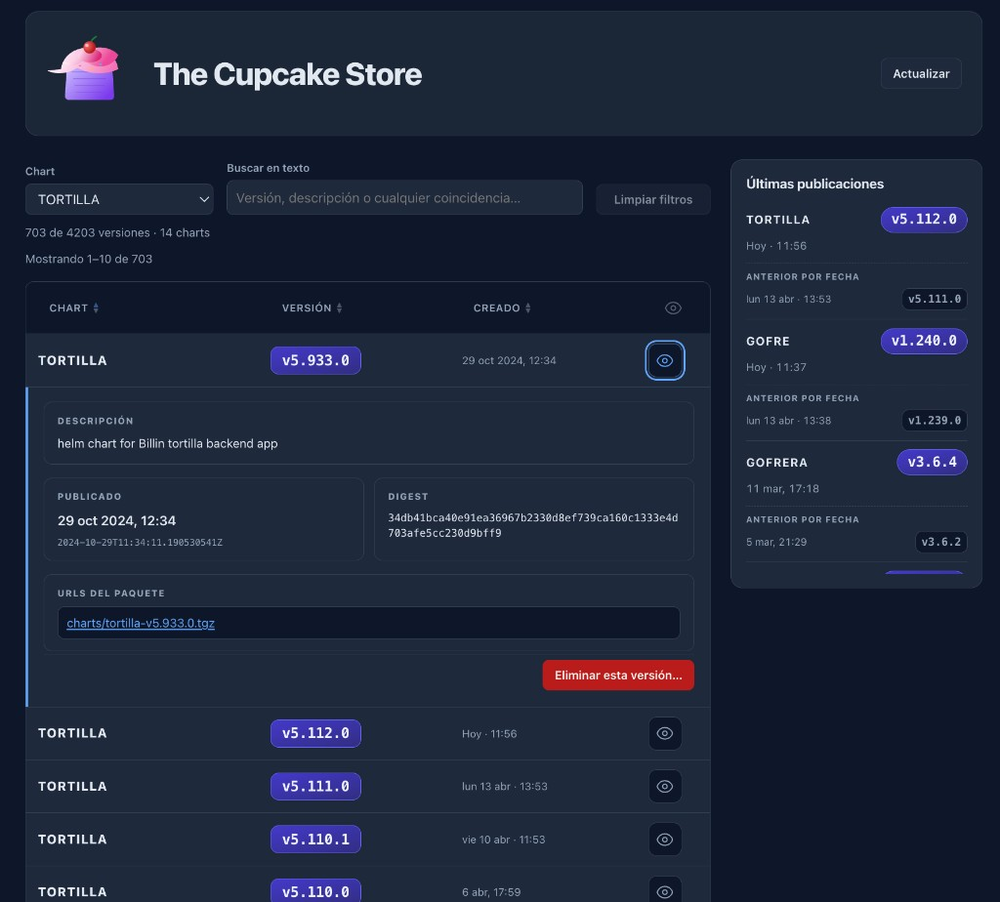

<p align="center">
  
</p>

# The Cupcake Store

UI para [ChartMuseum](https://chartmuseum.com) con **React**, **TypeScript** y **Vite 5**.

## Ejemplo de captura

Tabla de versiones con filtro por chart, detalle expandido (descripción, publicado, digest, URLs) y panel **Últimas publicaciones**.



## Requisitos

- Node.js **24.22.0** (`.nvmrc`), última LTS de la serie 24

## Comandos

```bash
npm install
npm run dev
```

| Comando | Descripción |
| ------- | ----------- |
| `npm run build` | Compilación para producción |
| `npm run preview` | Vista previa del build (mismo proxy que en dev) |
| `npm run lint` | ESLint |

## Configuración

La app llama a **`/chartmuseum/api/...`** en el mismo origen; en **`npm run dev`** y **`npm run preview`**, Vite hace de **proxy** hacia `CHARTMUSEUM_BASE_URL` e inyecta Basic Auth desde el `.env` (las credenciales no van al bundle del navegador).

Copia [`.env.example`](./.env.example) a `.env` y ajusta los valores:

| Variable | Descripción |
| -------- | ----------- |
| `PORT` | Puerto de dev/preview (opcional; por defecto 5173) |
| `CHARTMUSEUM_BASE_URL` | Origen del ChartMuseum **sin** barra final y **sin** `/api` (el proxy ya usa `/api/charts`) |
| `CHARTMUSEUM_USER` / `CHARTMUSEUM_PASSWORD` | Basic Auth (opcional) |
| `CHARTMUSEUM_REPO_PATH` | Multitenancy: ruta tras `/api` (opcional) |

Si falla la conexión con `localhost`, prueba `127.0.0.1` en la URL base.

**HTML en lugar de JSON:** revisa que la URL base apunte al ChartMuseum; en la terminal de `npm run dev` verás `[vite ChartMuseum] proxy → …`. Comprueba con `curl -sS -u 'USER:PASS' 'TU_URL/api/charts' | head -c 120` (debe ser JSON).

En un despliegue **solo estático** (sin servidor Vite) hará falta un **proxy inverso** equivalente que reescriba `/chartmuseum` hacia el museo y añada la autenticación.
